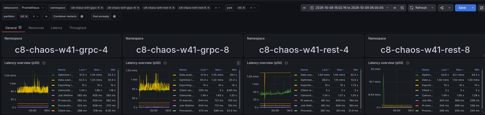
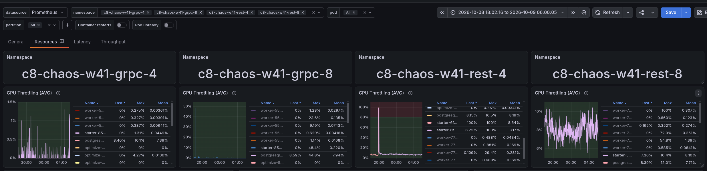
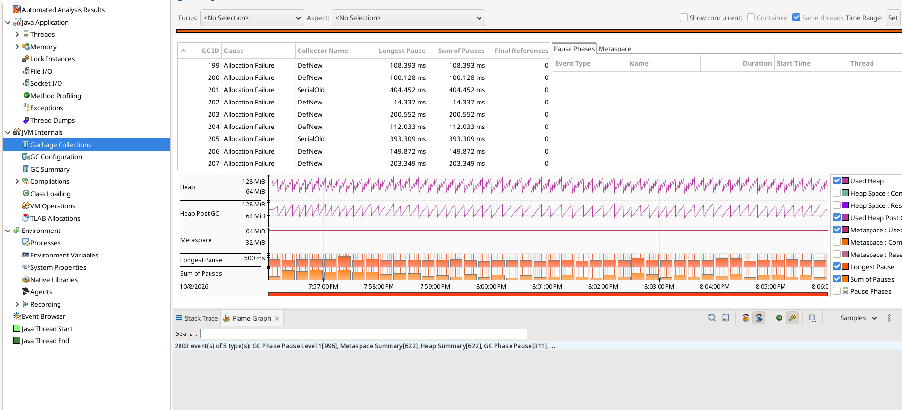
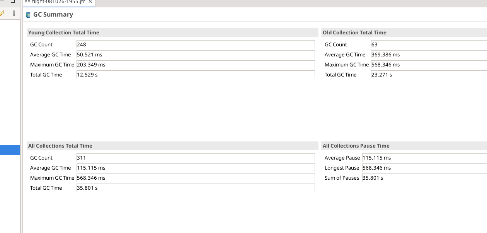
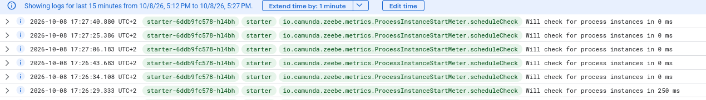
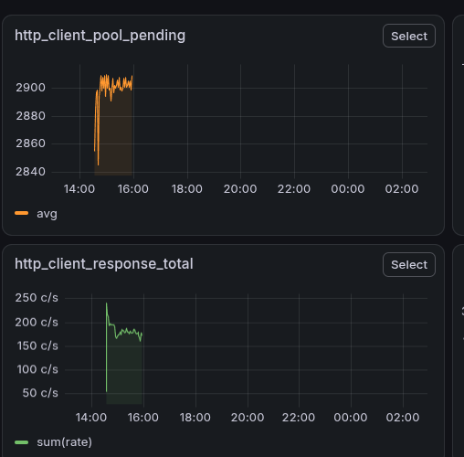
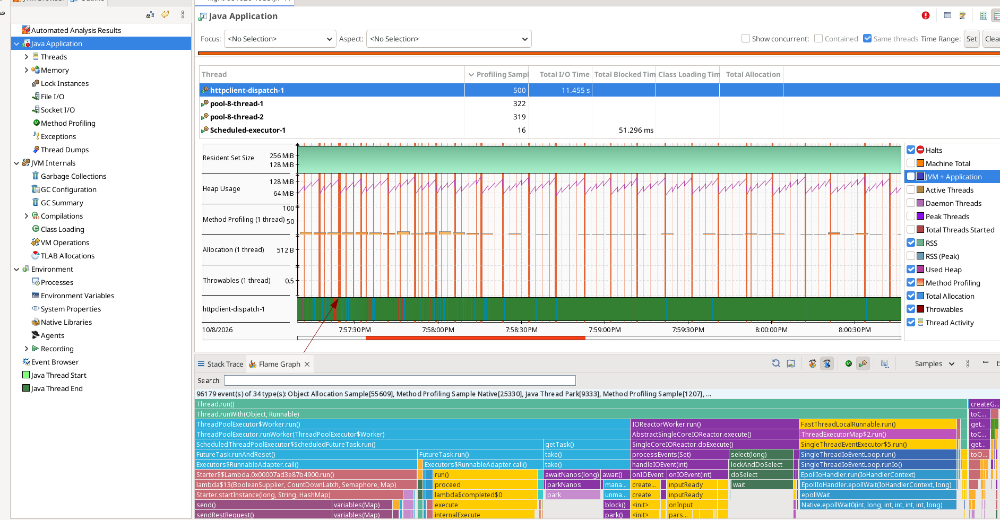

# Chaos Day Summary

Under stress, the data availability reported by our load tester ("how long after creation can a process instance be found via the search API") was at the 90 second limit of the report window for REST, but only about 45 to 50 seconds for gRPC. Today we wanted to find out whether the REST API, the gateway, or our load tester is responsible.

**TL;DR;** We found out that the 90 seconds delay seems to be a client-side effect, not a slow REST API.

- The REST search is not slower than with gRPC: the server answers `/v2/process-instances/search` in about 70 ms in both setups.
- The starter (the load tester application that creates process instances) used one Camunda client for creating instances at 300 PI/s *and* for the availability check. With REST, the connection pool of that client was fully leased (100 connections) with about 2,900 requests waiting, so the availability search waited in the same queue. The starter measured about 15 seconds for a query that took the server 70 ms.
- The availability check starts the next check only after the previous one completed, and returns at most 2,500 instances per check. With a 15 second cycle, it confirms at most about 167 instances per second. The rest is dropped after 90 seconds and recorded with the same metric as a real latency, so timeouts look like slow data availability.
- A second Camunda client only for the read requests brings the search time seen by the starter from about 15 seconds to about 0.1 seconds ([camunda/camunda#65355](https://github.com/camunda/camunda/pull/65355), merged). The mean data availability of the REST test drops from about 97 seconds to about 30 to 65 seconds, in the same range as gRPC (about 45 seconds).
- The remaining delay of about 45 seconds exists for both protocols. It is a queuing effect of the stress load: with more load, the exporter backlog grows, and data becomes searchable later.

<!--truncate-->

## Chaos Experiment

We ran load tests with REST and with gRPC side by side. We compared the server metrics, including the latency of the search requests, and the data availability measured by the starter. Note that the protocols are only used for starting and completing instances. For querying data, only the REST API exists.

Regarding setup, as usual the clusters have three Camunda pods with 3 CPUs each and Elasticsearch as secondary storage.
REST and gRPC with stress (max) load, each on 4 CPU nodes and on bigger, 8 CPU nodes. The CPU limit of the Camunda pods stayed the same.

### Expected

Either the client (again, see [Investigating load tester limits](../2026-10-01-Investigating-load-tester-limits/index.md)) or the gateway is the problem. If the search requests are slower on the server side with REST, the Camunda REST API is the suspect. If the server side looks the same for both protocols, the issue is in the load tester.

### Actual

We started four load tests: gRPC and REST, each on the standard and on the bigger nodes (the `-4` and `-8` namespaces).

We were able to reproduce the larger data availability issues for REST under stress load.

- gRPC was fine and similar on both node sizes.
- For REST, the data availability (p50 in the screenshot) was at the limit of the report window, 90 seconds. For gRPC it was about 52 seconds. This held for both REST setups.
- The server side looked the same: the exporter backlog and the flush latency were similar, and the search request latencies were similar, or even a bit lower for REST.
- The starter was throttled in about 8% of the CPU periods for REST, and in almost none for gRPC.
- The REST starter spent about 6% of its time in garbage collection pauses: 36 seconds in a 10 minute recording, with 63 full collections of about 370 ms on average and up to 570 ms. This can contribute to the delay, but it is not the root cause.

If the server is as fast for REST and the data is exported at the same pace, the high latency most likely comes from how the starter measures it.

#### How the starter measures data availability

The starter keeps every created process instance in a map, and checks regularly which of them can be found through the search API. It remembers the creation time and records the time until the instance is found. Instances that are not found after 90 seconds are removed and recorded with their age.

The starter logs every scheduled check of the availability meter. In the logs, most checks are rescheduled with a delay of 0 ms instead of the configured 250 ms, and they are 5 to 23 seconds apart, about 15 seconds on average in this excerpt. The number of instances the starter was waiting for kept increasing. The next check is scheduled only after the previous one completed, and a query that takes longer than the interval is followed immediately by the next check. A cycle of about 15 seconds therefore means that the query itself took about 15 seconds.

The metrics confirmed this. A snapshot during the stress runs (the data availability here is the mean, so it is a bit lower than the p50 of the screenshot above):

| Namespace | Pending instances | Query duration seen by the starter | Mean data availability |
|---|---|---|---|
| gRPC, 4 CPU nodes | 7.8k | 0.07 s | 45 s |
| gRPC, 8 CPU nodes | 7.7k | 0.08 s | 42 s |
| REST, 4 CPU nodes | 15.9k | 14.7 s | 97 s |
| REST, 8 CPU nodes | 12.9k | 17.6 s | 99 s |

The server-side duration of the search request is about 70 ms for both REST and gRPC. In REST, the starter sees 14.7 seconds for the same request. A heap dump of the starter agrees: it held 16,059 instances waiting for their availability.

Two effects follow from this:

1. Each check can confirm at most 2,500 instances (the page size of the search) and takes about 15 seconds: `2500 / 15` is about 167 instances per second. With 200 or more instances per second created, instances wait until they hit the 90 second limit.
2. The timeouts are recorded in the same metric as the real latencies. The upper bucket of the histogram is the 90 seconds, so a timeout is indistinguishable from an instance that was really found after 90 seconds.

#### Why does the query take 15 seconds?

The availability query uses the same Camunda client as the creation of process instances. With gRPC, the creation runs over gRPC and the client's HTTP connections are used by the search only. With REST, the starter sends about 300 requests per second over the same HTTP client, and the search has to queue behind them like any other request.

The HTTP client metrics we added in the [previous chaos day](../2026-10-01-Investigating-load-tester-limits/index.md) show it. They exist only through a proof of concept in the starter ([camunda/camunda#64528](https://github.com/camunda/camunda/issues/64528) asks for a supported way). The REST starter has all 100 connections of its pool leased and about 2,900 requests pending.

With about 2,900 pending requests and about 180 completed requests per second, a new request waits around 2,900 / 180 = 16 seconds in the queue (if it is processed in order). This matches the 15 seconds of the availability query.

The queue is not only the pool of connections. A JFR recording of the REST starter shows that the client runs all its HTTP traffic through a single I/O thread (`httpclient-dispatch-1`, in a single-core I/O reactor). It has the most CPU samples, 500 of 1,207, ahead of the two threads that send the requests (about 320 each).

We tried several things to confirm and fix it, with these results:

1. A standalone starter that only calls the search API with 2,000+ process instance keys in the filter: about 2 seconds, compared to about 400 ms without a filter. Slower, but far from 15 seconds. A k6 script (a load testing tool) shows the same, so it is not specific to Java or the starter.
2. A bigger connection pool (500 instead of 100), more threads for the data availability meter (5 instead of 1), and ten times the CPU for the starter (2500m instead of 250m): no visible change.
3. A **second Camunda client only for the read requests**: the search time seen by the starter dropped from about 15 seconds to below 500 ms. The server execution time did not change, only the time until the starter code got its response.

A bigger pool alone did not help, so the pool size is not the whole bottleneck, and the single I/O thread is a candidate. The second client has its own pool and its own I/O thread, so this experiment does not tell which of the two caused the queue.

The second client separates the "loader" from the "reader" in the starter ([camunda/camunda#65355](https://github.com/camunda/camunda/pull/65355), merged), which also makes the application easier to reason about.

#### With the separate client

After the change was deployed to the REST test on 4 CPU nodes, the starter measures about 0.12 to 0.15 seconds for the availability query (before: 14.7 seconds). The mean data availability is now about 30 to 65 seconds (before: 97 seconds), which is in the range of gRPC (mean of 42 to 45 seconds). The Camunda REST API was not the reason for a higher data availability.

#### The remaining 45 seconds

Under stress, process instances still take about 45 seconds until they can be found with the search API, for REST and for gRPC. The query is fast now, so this is not a measurement effect of the client. It is a queuing effect: under the higher load, the exporter backlog is bigger, and the data reaches the secondary storage later. The exporter backlog was the same for REST and gRPC in the stress tests: both clusters stayed about 320,000 to 390,000 records behind the committed log (summed over all partitions) while exporting about 8,000 to 10,000 records per second. That is a backlog of roughly 35 to 45 seconds, which matches the data availability we measure for both protocols.

## Conclusion

The Camunda REST API is not the reason for the higher data availability of the REST test. It was dominated by our own load tester: the query that measures it waited in the same client queue as the creation of process instances, took about 15 seconds, and could only confirm a part of the waiting instances. The rest ended at the 90 second limit, and the metric recorded these timeouts like real latencies. With a separate client, REST and gRPC show the same data availability, bounded by the exporter backlog under stress load.

What we learned:

- Under high load, reads and writes of a REST client compete for the same queue (connections and the I/O thread), and a metric measured through that client measures the queue as well.
- Timeouts must stay visible in the latency metric, and should also be counted, so that a plateau at the limit is recognized as timeouts. Hiding them would have hidden this problem.
- The client metrics were essential to see the queue, but we had to hack them in again. They need to be a supported feature of the Java client.
- Searching with many process instance keys is expensive (about 2 seconds for 2,000 keys), so the load tester should query fewer keys.

## Found Bugs and Follow-ups

- Separate Camunda client for the availability queries in the starter: [camunda/camunda#65355](https://github.com/camunda/camunda/pull/65355) (merged)
- Make the data availability meter observable and robust: [camunda/camunda#65371](https://github.com/camunda/camunda/issues/65371)
- Query fewer process instance keys for the data availability: [camunda/camunda#65520](https://github.com/camunda/camunda/issues/65520)
- Log the effective starter and worker configuration: [camunda/camunda#65372](https://github.com/camunda/camunda/issues/65372)
- Investigate the latency of searching with thousands of keys: [camunda/camunda#65373](https://github.com/camunda/camunda/issues/65373)
- Expose the HTTP client metrics of the Java client: [camunda/camunda#64528](https://github.com/camunda/camunda/issues/64528)
