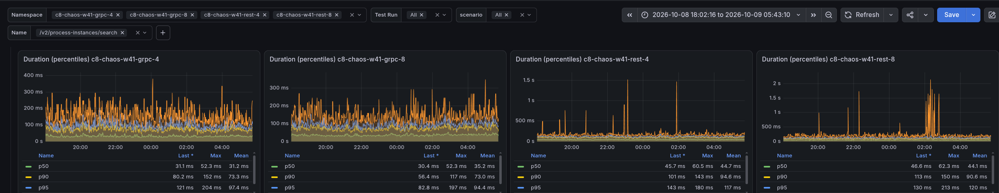
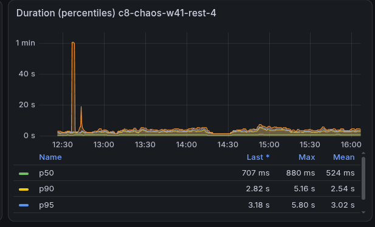

# Chaos Day Summary

Under stress, the data availability reported by our load tester ("how long after creation can a process instance be found via the search API") was at the 90-second limit for REST (p50), but about 52 seconds (p50) for gRPC. Today, we wanted to find out whether the REST API, the gateway, or our load tester is responsible.

**TL;DR:** The 90-second plateau is a client-side effect of the load tester, not a slow REST API.

- The search is the same REST endpoint in both setups, whether instances are created through REST or gRPC, and the server answers `/v2/process-instances/search` with a p50 of about 30 to 47 ms and a p90 of about 73 to 95 ms in all four tests (REST slightly higher).
- The starter (the load tester application that creates process instances) uses one Camunda client for creating instances (target: 300 process instances per second) *and* for the availability check. With REST, requests queue up in the client (all 100 pooled connections are leased, with about 2,900 requests waiting), and the availability search waits in the same queue. The starter measured about 15 seconds for a query that took the server 70 ms.
- The availability check starts the next check only after the previous one is completed, and returns at most 2,500 instances per check. With a 15-second cycle, it confirms at most about 167 instances per second, an upper bound that real checks stay below. Instances that are not confirmed in time are dropped after 90 seconds and recorded with the same metric as real latency, so timeouts appear as slow data availability.
- A second Camunda client only for the read requests brings the search time seen by the starter from about 15 seconds to about 0.12 to 0.15 seconds ([camunda/camunda#65355](https://github.com/camunda/camunda/pull/65355), merged). The mean data availability of the REST test is about 57 to 68 seconds with this client (97 to 99 seconds without it). For gRPC, it is about 45 seconds.
- The remaining delay is related to the exporter backlog under the stress load, which can be estimated on the server side as `backlog / export rate`
<!--truncate-->

## Chaos Experiment

We ran load tests with REST and with gRPC side by side. We compared server metrics, including search request latency and data availability, as measured by the starter. Note that the protocols are used only to start and complete instances. For querying data, only the REST API exists.

Regarding setup, as usual, the clusters have three Camunda pods, each with a limit of 3 CPUs, and Elasticsearch as secondary storage. We ran REST and gRPC under stress (max) load, each on 4 CPU nodes and on larger 8 CPU nodes, with the pods' CPU limit unchanged.

### Expected

Either the client (see [Investigating load tester limits](../2026-10-01-Investigating-load-tester-limits/index.md)) or the gateway is the problem. If the search requests are slower on the server side with REST, the Camunda REST API is the suspect. If the server-side looks the same for both protocols, that points to the load tester, which we then test.

### Actual

We started four load tests: gRPC and REST, each on the standard and on the bigger nodes (the `-4` and `-8` namespaces).

We were able to reproduce the larger data availability issues with REST under stress.

- gRPC was fine and similar on both node sizes.
- For REST, the data availability (p50 in the screenshot) was at the 90-second limit of the load tester. For gRPC, the p50 was about 52 seconds. This held for both REST setups.
- The server side looked the same: the exporter backlog was similar, and the search request latencies were similar.
- The starter was throttled in about 8% of the CPU scheduling periods (the share of Linux CFS periods in which the container hit its CPU limit) for REST, and in almost none for gRPC.
- The REST starter spent about 6% of its time in garbage collection pauses: 36 seconds in a 10-minute recording, of which 63 full collections took about 23 seconds (about 370 ms on average, up to 570 ms). This could add to the delay (we did not measure its effect separately), but it does not appear to be the main cause: increasing the CPU for the starter 10x changed nothing (see below).

If the server is as fast for REST and the data is exported at the same pace, the hypothesis is that the high latency comes from how the starter measures it. The following sections test it.

#### How the starter measures data availability

The starter keeps every created process instance in a map and regularly checks which of them can be found via the search API. It remembers the creation time and records the time until the instance is found. Instances not found after 90 seconds are removed and recorded along with their age.

The starter logs every scheduled check of the availability meter. In the logs, most checks are rescheduled with a delay of 0 ms instead of the configured 250 ms, and they are 5 to 23 seconds apart, about 15 seconds on average in this excerpt. The number of instances the starter was waiting for kept increasing. The next check is scheduled only after the previous one is completed, and a query that takes longer than the interval is followed immediately by the next check. A cycle of about 15 seconds means the query itself took about 15 seconds.

The metrics confirmed this. A snapshot during the stress runs (the data availability here is the mean, not the p50 of the screenshot above; the REST means exceed 90 seconds for the reason given below the table):

| Namespace | Pending instances | Query duration seen by the starter | Mean data availability |
|---|---|---|---|
| gRPC, 4 CPU nodes | 7.8k | 0.07 s | 45 s |
| gRPC, 8 CPU nodes | 7.7k | 0.08 s | 42 s |
| REST, 4 CPU nodes | 15.9k | 14.7 s | 97 s |
| REST, 8 CPU nodes | 12.9k | 17.6 s | 99 s |

The server-side duration of the search request is a p50 of about 30-47 ms for both REST and gRPC (REST slightly higher).

In REST, the starter sees 14.7 seconds for the same request. A heap dump of the starter confirms the number of pending instances: it held 16,059 instances waiting for their availability.

The REST means are above the 90-second limit because timed-out instances are removed only after a check is completed, so their recorded age is 90 seconds plus up to one cycle of about 15 seconds.

Two effects follow from this:

1. Each data-availability check can confirm at most 2,500 instances (the page size of the search) and takes about 15 seconds: `2500 / 15` is about 167 instances per second. This is an upper bound and not the full explanation: the REST starter completes about 180 creation requests per second (the target is 300), close to the 167 per second a check can confirm, yet most observations sit at or near the 90-second limit (mean above 90 seconds). We did not measure how many instances a check really returns, so the effective confirm rate is lower than the bound for a reason we have not isolated. A check can only return instances that are already exported, and the filter of a query holds all pending keys (up to 16,000) while a response returns at most 2,500 instances, so many of the keys can belong to instances that are still in the exporter backlog.
2. The timeouts are recorded in the same metric as the real latencies. The upper bucket of the histogram is the 90 seconds, so a timeout (recorded with an age of 90 seconds or a bit more) lands in the same bucket as an instance that was really found after 90 seconds and cannot be told apart.

#### Why does the query take 15 seconds?

The availability query uses the same Camunda client as the creation of process instances. With gRPC, the creation runs over gRPC, and the client's HTTP connections are used by the search only. With REST, the starter sends about 300 requests per second over the same HTTP client, and the search has to queue behind them like any other request.

The HTTP client metrics we added in the [previous chaos day](../2026-10-01-Investigating-load-tester-limits/index.md) show it. They exist only through a proof of concept in the starter ([camunda/camunda#64528](https://github.com/camunda/camunda/issues/64528) asks for a supported way). The REST starter has all 100 connections of its pool leased and about 2,900 requests pending.

With about 2,900 pending requests and about 180 completed requests per second, a request waits on average around 2,900 / 180 = 16 seconds in the queue (Little's law). This matches the 15-second availability query.

The queue may not only be the pool of connections. A JFR (Java Flight Recorder, a profiler) recording of the REST starter shows that the client routes all its HTTP traffic through a single I/O thread (`httpclient-dispatch-1`) in a single-core I/O reactor. It has the most CPU samples, 500 of 1,207, ahead of the two threads that send the requests (about 320 each). This shows it is the busiest thread, not that it is saturated.

We tried several things to confirm and fix it, with these results:

1. A standalone starter that only calls the search API with 2,000+ process instance keys in the filter: about 2 seconds, compared to about 400 ms without a filter. Slower, but far from 15 seconds. A k6 script (a load testing tool) with 2,000 keys in the filter shows the same: a p50 of about 0.5 to 0.7 seconds and a p90 of about 2.5 to 2.8 seconds, with one spike to about a minute. The cost is not specific to Java or the starter.

2. A bigger connection pool (500 instead of 100), more threads for the data availability meter (5 instead of 1), and ten times the CPU for the starter (2500m instead of 250m): no visible change.
3. A **second Camunda client only for the read requests**: the search time seen by the starter dropped from about 15 seconds to about 0.12 to 0.15 seconds. The server execution time did not change, only the time until the starter code got its response.

A bigger pool alone did not help, so the pool size is not the whole bottleneck, and the single I/O thread is a **candidate**. The second client has its own pool and its own I/O thread and showed better results.
The second client separates the "loader" from the "reader" in the starter ([camunda/camunda#65355](https://github.com/camunda/camunda/pull/65355), merged), which also makes the application easier to reason about.

#### With the separate client

After the change was deployed to the REST test on 4 CPU nodes, the starter measured about 0.12 to 0.15 seconds for the availability query (before: 14.7 seconds). The mean data availability was then about 57 to 68 seconds (before: 97 seconds), compared to a mean of 42 to 45 seconds for gRPC. The Camunda REST API is not the reason for the higher data availability, and the remaining difference to gRPC is explained below.

#### The remaining delay

With the separate client, process instances take about 45 seconds (gRPC) to about 60 seconds (REST) until the search finds them. The query is fast now, so it is no longer the reason.

**The exporter backlog.** Under the stress load, the exporter is behind. Both clusters stayed about 320,000 to 390,000 records behind the committed log (summed over all partitions, so the estimate assumes backlog and throughput are spread evenly across partitions) while exporting about 8,000 to 10,000 records per second (exported and skipped records). Records are exported in order, so a new record waits about `backlog/export rate` until it is exported, which is about 32 to 49 seconds. This is the same for REST and gRPC. The exporting latency metric cannot show it, because its top bucket is 10 seconds, so the backlog-based estimate is the server-side signal.

## Conclusion

The search API is not the reason for the higher data availability of the REST test, and the measurements attribute the REST creation latency to the shared client queue. We did not compare the server-side creation latency or the achieved creation rate of gRPC. The original REST measurement was dominated by our own load tester: the query that measures it waited in the same client queue as the creation of process instances, took about 15 seconds, and could only confirm a part of the waiting instances. The rest ended at the 90-second limit, and the metric recorded these timeouts like real latencies. With a separate client, the remaining difference in data availability between REST and gRPC is consistent with the latency of the creation request, and both include a substantial delay from the exporter backlog under the stress load.

What we learned:

- Under high load, reads and writes of a REST client compete for the same queue in the client (pool or I/O thread, our experiments do not separate them), and a metric measured through that client measures the queue as well.
- Timeouts must stay visible in the latency metric, and should also be counted, so that a plateau at the limit is recognized as timeouts. Hiding them would have hidden this problem.
- The client metrics were essential to see the queue, but we had to hack them in again. They need to be a supported feature of the Java client.
- The exporting latency metric is capped at 10 seconds, so it cannot show a backlog of 40 seconds. The exporter backlog divided by the export rate approximates the data availability on the server side.
- Searching with many process instance keys is expensive (about 2 seconds for 2,000 keys). The load tester sends up to 16,000 keys, where the cost is not measured yet, so it should query fewer keys.

## Found Bugs and Follow-ups

- Separate Camunda client for the availability queries in the starter: [camunda/camunda#65355](https://github.com/camunda/camunda/pull/65355) (merged)
- Make the data availability meter observable and robust: [camunda/camunda#65371](https://github.com/camunda/camunda/issues/65371)
- Query fewer process instance keys for the data availability: [camunda/camunda#65520](https://github.com/camunda/camunda/issues/65520)
- Log the effective starter and worker configuration: [camunda/camunda#65372](https://github.com/camunda/camunda/issues/65372)
- Investigate the latency of searching with thousands of keys: [camunda/camunda#65373](https://github.com/camunda/camunda/issues/65373)
- Expose the HTTP client metrics of the Java client: [camunda/camunda#64528](https://github.com/camunda/camunda/issues/64528)
