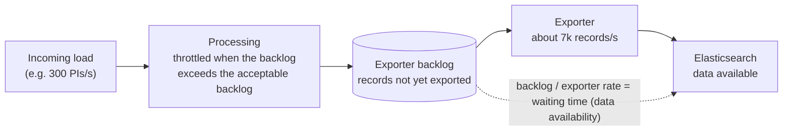
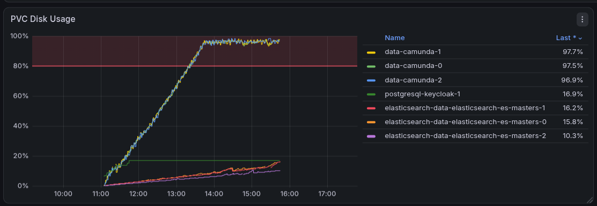

# Chaos Day Summary

During writing our Sizing documentation for Camunda, we noticed that our previous load tests did not account for the default flow control settings.

Which for example impacted our experiments for [Camunda 8.7 and beyond performance and reliability results](https://camunda.github.io/zeebe-chaos/2026/08/14/Camunda-8.7-and-beyond---performance-and-reliability). That means our results did not describe what we ship.

Today we ran several load tests with different flow control settings to understand how flow control affects throughput and data availability, and whether our earlier results need a correction.

<!--truncate-->



The acceptable backlog only sizes the queue in the middle, and with it the waiting time. The exporter rate on the right decides how many records per second can pass, no matter how large or small the queue is.

**TL;DR;**

- The acceptable backlog is the knob for data availability: a large backlog means a large export delay, a small backlog a small one. The p99 data availability was about 59s with the default backlog (100k), 44s with 10k and 30s with 5k.
- Camunda ships with the write flow control disabled. Under our stress load (300 PIs/s, more than the cluster can sustain) and without it, the cluster processed about 295 PIs/s for roughly 2.5 hours, while the exporter backlog grew to about 46 million records, until the disks were almost full. Afterwards the throughput dropped to about 190 PIs/s.
- The maximum PIs/s is bound by the exporter throughput divided by the records per PI (about 37 exported records per PI). With 7k records/s this is about 190 PIs/s.
- A backlog of 5k, below what the exporter handles per second, cost about 14% throughput compared to 10k, because the exporter throughput dropped as well.
- A write limit that is too low starves partitions. With a limit of 100 only partition one made progress, and the other partitions could not finish bootstrapping.
- Under a realistic load (~51 PIs/s) the default configuration without flow control ran stable for about 22 hours, with a p99 data availability of 3.9s and almost no backlog.
- Going forward, load tests run with the default (vanilla) configuration. Tests with a specific flow control configuration are separate, explicit scenarios.
- We found two bugs along the way: deployments are redistributed on every redeploy, and Elasticsearch shards are unevenly used.

## Chaos Experiment

As we wanted to understand how flow-control works and impacts the system we ran several load tests with different flow control settings.

We used the max/stress scenario with 300 PIs/s and our [default load test setup](https://github.com/camunda/camunda/blob/880ec51f24c5dff162f70257d27059595bd4cd99/load-tests/setup/main/values/camunda-platform-values-defaults.yaml#L246-L252) as the base (using the REST API). Our default load test setup enables the following flow control configuration:

```yaml
camunda.processing.flow-control.write.enabled: "true"
camunda.processing.flow-control.write.limit: 10000
camunda.processing.flow-control.write.throttle.enabled: "true"
```

See the [flow control documentation](https://docs.camunda.io/docs/next/self-managed/operational-guides/configure-flow-control/#enable-flow-control) for the meaning of these settings. The default of `acceptable-backlog` is 100000 (`camunda.processing.flow-control.write.throttle.acceptable-backlog`), which we haven't changed in our default setup. Note that Camunda itself ships with the write limit and the throttling disabled, see the [configuration defaults](https://github.com/camunda/camunda/blob/93eed7e8765965643acda91fc6e389d0328155b8/dist/src/main/config/defaults.yaml#L1806-L1821). Only the request limit (backpressure) is enabled by default, and it stays enabled in all our variations.

We started one cluster per variation:

- **Base** (`c8-chaos-w42-baseline`): 300 PIs/s, default load test setup.
- **More PIs** (`c8-chaos-w42-pis-400`): `load-tester.starter.rate: 400`.
- **Lower write limit** (`c8-chaos-w42-lower-limit`): `camunda.processing.flow-control.write.limit: 100`.
- **Lower backlog** (`c8-chaos-w42-lower-limit-backlog`): `camunda.processing.flow-control.write.throttle.acceptable-backlog: 10000`.
- **No flow control** (`c8-chaos-w42-no-limit`): the three lines above removed from the default load test setup (this is the Camunda default configuration).

Later we added a sixth cluster after discussing the results:

- **Backlog 5k** (`c8-chaos-w42-backlog-5k`): `camunda.processing.flow-control.write.throttle.acceptable-backlog: 5000`.

### Expected

Before we started with our tests we made some expectations based on our understanding of the flow control settings and the system behavior.

- **Base:** as usual about 220 PIs/s, a backlog of about 100k records per partition, and a data availability delay of 40 to 60 seconds.
- **More PIs:** we already reach the limit with 300 PIs/s, so more load should not change the result. It might even be slightly worse because of overstress.
- **Lower write limit:** a significant throughput drop, but good data availability and no backlog.
- **Lower backlog:** a throughput drop, good data availability, and a backlog as configured.
- **No flow control:** more PIs/s, but a huge backlog and worse data availability than the other configurations.

### Actual

The numbers below come from Prometheus over the whole run (about 3 to 4 hours per cluster). The backlog is the number of records not yet exported, per partition (3 partitions) and the data availability the time from creating an instance until it is available via the REST API, as measured by the load tester (see [metrics documentation](https://github.com/camunda/camunda/blob/cccaef90819cd9456cfa4d3b2a3039a08ed8c84a/load-tests/docs/metrics.md#L215-L218)). Data availability is given as p50 and p99 over the whole run.


- **Base:** 246 PIs/s at the start, on mean around 220 PIs/s. About +/-105k records not exported as backlog. Data availability: p50 40s, p99 59s.
- **More PIs:** Shows quite similar picture to the base, with 239 to 225 PIs/s, with similar backlog and data availability (p50 41s, p99 60s).
- **Lower write limit:** at the start 3 PI/s, later about 30 PIs/s (after configuration change, see below). The backlog was close to zero, still the data availability was unexpectedly high (p50 37s, p99 45s, see below).
- **Lower backlog (10k):** 150 to 210 PIs/s, mean around 200. The backlog stayed on mean around 35k records per partition. Data availability: p50 23s, p99 44s.
- **No flow control:** high processing throughput, about 295 PIs/s for the first 2.5 hours, then about 190 PIs/s. The total backlog grew to about 46 million records. Data availability was no longer measurable, it was in the top bucket (90s) of the histogram.
- **Backlog 5k:** Started with 220 as well, then dropped to 173 to 182 PIs/s. The backlog was on mean around 30k records per partition. Data availability: p50 22s, p99 30s. The p50 is the same as with 10k, only the tail improved. A single 15 minute window of the run (for both 10k and 5k) reached the top bucket of 90s, which we relate to restarts of the cluster.


#### Base

The base behaved as in previous runs, with a backlog of about 105k records per partition per exporter.


While looking at the base we noticed that deployments are continuously distributed to the other partitions. Our k6 script deploys the same resources again and again. A redeploy of identical resources should be idempotent, but a command distribution is created every time. Something we need to follow up with.


#### Lower write limit

When setting the write limit to a lower value, we tried to estimate what this would mean to our throughput. As this is not obvious from the user point of view (when setting record limit).

We tried to approximate how many records a single PI writes in our load test for our stress workload (one start event, a service task and an end event). Each process instance and flow node instance writes ~4 records, a job ~3 records, and we create 14 variables per process instance (see [typical payload](https://github.com/camunda/camunda/blob/main/load-tests/load-tester/src/main/resources/bpmn/typical_payload.json)). See [ZEP-004](https://github.com/zeebe-io/enhancements/blob/master/ZEP004-wf-stream-processing.md) for how the stream processing writes these records, and [camunda/camunda#61073](https://github.com/camunda/camunda/issues/61073) for related work on sizing by records per process model.

```python
# Number of records per flow node instance
fni = 4
# Number of records per job
job = 3
# Number of records per process instance container
picontainer = 4
# Number of variables per process instance
variables = 14

# Total number of records per process instance
# Our process has three flow nodes (start event, service task, end event)
total_records = (1 * picontainer) + (3 * fni) + (1 * job) + variables
print(total_records)  # 33
```

This makes `33` records per process instance. As the limit is set to 100 per partition we can expect ~3 PIs/s per partition (`100 / 33`), which is about 9 PIs/s for our whole cluster.

When we look at the metrics, we can see that the throughput aligns with our expectations for one partition only.


Looking closer, partition one did much more than the other partitions.


Only partition one created PIs, jobs and variables.


The other partitions only received PI creation commands, and almost everything was rejected.


We also saw authorization commands being rejected and retried. These commands are created internally to bootstrap a partition. Our theory is that the rejections prevented the partitions from bootstrapping fully.


The deployment distribution was affected as well. It could not succeed while the partitions were rejecting commands.


The data availability was high as well (p50 37s, p99 45s), although the exporting latency p99 was only about 0.09s and there was no backlog. This means the delay is not caused by the exporter. Our theory is that the write limit slows down the processing: commands like the PI creation are accepted, but their follow-up writes are rejected by the limit and retried by the engine until capacity is free again. The instance is then created and visible late. We did not verify this.

##### Raising the limit

We raised the limit from 100 to 350 to see whether the limit correlates with what we saw in the metrics. After the change the authorization commands succeeded, the partitions started to complete jobs, and the deployment distribution finished.


With a limit of 350 (and 33 records per process instance) we would expect ~10 PIs/s per partition (`350 / 33`) and indeed the cluster reached about 30 PIs/s. The accepted writes were about 480 records/s per partition though, which is higher than the configured limit of 350. We did not investigate how exactly the limit maps to the accepted writes (for example which write sources count against it).


#### Lower backlog

With an acceptable backlog of 10k we still reached a high throughput of about ~200 PIs/s.


The exporter backlog is about three times lower than in the base (about 35k vs 105k per partition). It is not exactly the configured value, so the setting does not behave like a hard per-second bound.

What we are configuring here is the soft limit of the exporter backlog. It determines how many records can be queued before flow control kicks in, but it does not act as a strict per-second limit.

Important to note here is that a higher limit doesn't necessary help, as this only a short-term buffer and does not increase the exporter's processing capacity. The key factor is how fast the exporter can process the queued records. The queue limit has a direct effect on the data availability latency. 

This is directly related to queuing theory (like Little's Law): the waiting time in a queue is its size divided by the rate at which it is served.


#### No flow control

Without flow control (no exporter backlog limit) we reached about 295 PIs/s, but the exporter backlog kept growing until it reached about 46 million records. The exporting throughput is lower than the processing throughput, so nothing slows the processing down.

At around 13:40, about 2.5 hours after the start, the disks of the Camunda pods were almost full (about 97%). This lines up with the throughput drop.



This is what queueing theory predicts. The arrival rate (295 PIs/s, about 10.9k records/s) is higher than the service rate of the exporter (about 7k records/s), so the queue grows by about 3.9k records/s. Over 2.5 hours this is in the order of the 46 million records we saw. A queue without a limit grows until a finite resource is exhausted, here the disk. As soon as the buffer is full, the system can only admit as much as it serves, so the throughput falls to the service rate, `7000 / 37`, about 190 PIs/s. This is also what we measured afterwards, with a much higher backlog and data availability (in queuing theory terms, a higher system waiting time). The mechanism behind it is the disk monitoring of the broker. Our load test setup configures that the broker rejects client commands and pauses processing when less than 3GB of disk space is free, and stops accepting replicated events below 2GB ([load test configuration](https://github.com/camunda/camunda/blob/880ec51f24c5dff162f70257d27059595bd4cd99/load-tests/setup/main/values/camunda-platform-values-defaults.yaml#L240-L241), the [defaults](https://github.com/camunda/camunda/blob/93eed7e8765965643acda91fc6e389d0328155b8/dist/src/main/config/defaults.yaml#L548-L559) are 2GB and 1GB). Processing continues when snapshots and compaction free space again, which is why the disk usage in the graph stays at the watermark instead of growing further. So the free space watermark was the effective limit for the backlog, not flow control.


#### Comparison and the 5k backlog

In the investigation and discussion we realized that the acceptable backlog only tunes the data availability. A large backlog leads to a large export delay and a small backlog to a small one.

The throughput is only slightly affected by the limit. What matters more is how fast the exporter cleans up and how fast new data can be accepted. Without flow control we reach 300 PIs/s because the exporter throughput is not respected (until we reach the disk limit). With the backlog enabled, processing waits for the exporter, so the exporter throughput sets the pace.

See the diagram at the top: the acceptable backlog only sizes the queue, the exporter rate sets the throughput.

This also lets us calculate the maximum PIs/s: exporter throughput divided by records per process instance. The exporters exported 37.0 records per completed process instance in Prometheus (base, 10k and 5k cluster). This is a bit more than the 33 records we calculated for the write limit, as it also contains records that do not belong to a process instance, for example from the continuous deployments and their distribution. We did not break this down. With 37 records per PI and an exporter throughput of 7k records/s the maximum is `7000 / 37`, about 190 PIs/s.

This led to a thought: what if the backlog is lower than the throughput the exporter can sustain? How would the system behave? Would we still be able to achieve the same throughput with an even better data availability?

We started `c8-chaos-w42-backlog-5k` to test this. We expected a lower backlog and better data availability at the same throughput, unless the limit is too low, in which case the throughput suffers.


The measured exporter throughput was about 7.9k records/s with the 10k backlog and 7.0k records/s with the 5k backlog. Divided by 37 records per PI this is about 213 and 188 PIs/s, which matches the PIs/s we measured (218 and 188). So the 5k backlog did not slow down the processing directly, it lowered the exporter throughput, and the processing follows the exporter.

A backlog of 5k is less than one second of exporting (about 30% below the 7k records/s). Queueing theory explains why this hurts. The exporter serves the queue in batches, and every batch has a fixed cost (the bulk request to Elasticsearch) on top of the cost per record. With a small queue the batches are small, the fixed cost is spread over fewer records, and the service rate drops, while a larger queue amortizes it. The PIs/s we measured follow this: about 220 (default 100k backlog), 218 (10k) and 188 (5k), so a larger buffer helps with diminishing returns, and a too small buffer starves the exporter. Compared to 10k, the throughput dropped by about 14% (188 vs 218 PIs/s). We did not measure the batch sizes, so the batching itself is an assumption.


We assume a backlog around 8k gives the best combination of throughput and data availability. We did not test that.

The backlog also did not shrink as much as we expected. We did not find out why.

#### Uneven load on Elasticsearch


While looking at the 5k cluster we saw an uneven distribution of documents across the Elasticsearch shards, which in general impacts our throughput as well.

Looking into shard distribution, we can see that some shards hold significantly more documents than others. In addition, we stumbled over some indices with more shards than expected.


```
$ curl -s "localhost:9200/_cat/shards/zeebe*?v=true&bytes=gb"
index                                           shard prirep state       docs store dataset ip           node
zeebe-record_process-instance_8.11.0_2026-10-15 0     p      STARTED  3021041     0       0 10.152.31.66 elasticsearch-es-masters-1
zeebe-record_process-instance_8.11.0_2026-10-15 1     p      STARTED        0     0       0 10.152.25.2  elasticsearch-es-masters-0
zeebe-record_process-instance_8.11.0_2026-10-15 2     p      STARTED        0     0       0 10.152.25.2  elasticsearch-es-masters-0
zeebe-record_process-instance_8.11.0_2026-10-15 3     p      STARTED  2708256     0       0 10.152.31.66 elasticsearch-es-masters-1
zeebe-record_process-instance_8.11.0_2026-10-15 4     p      STARTED  2898537     0       0 10.152.25.2  elasticsearch-es-masters-0
```

Of the five process instance shards, two are empty. The exporters route each document by its partition id, so with three partitions only three distinct routing values exist, and these can collide in the same shard. [camunda/camunda#56522](https://github.com/camunda/camunda/pull/56522) changes the shard counts to 5 to address this, and the three used shards above are indeed even. But the change is only on main, and it only helps for exactly 3 partitions. An 8.10.4 cluster still shows one empty shard and one shard with twice the documents of another, and we simulated the routing for other partition counts (for example 6 partitions end up as 2, 1, 0, 2, 1 on 5 shards). This leads to uneven load per Elasticsearch node and different performance between otherwise identical clusters, see [camunda/camunda#66172](https://github.com/camunda/camunda/issues/66172).

The unevenness is not limited to the Zeebe record indices, it affects all indices we create (Zeebe, Operate, Tasklist, Camunda and Optimize). Most of the Operate, Tasklist and Camunda indices have a single primary shard, so each heavy index (for example list view, flow node instance, variable and task) is one hot shard, and Elasticsearch decides on which node it lives. As far as we know Elasticsearch balances shards by their count and disk usage, not by the document volume or the indexing load, so nothing prevents several heavy indices from ending up on the same node. On an 8.10.4 cluster the heavy indices of one day (47M list view, 21M flow node instance, 26M Zeebe variable and 6M job documents) have their primaries on the same node (`elasticsearch-es-masters-1`, about 100M documents in total), while another node holds primaries with about 39M documents. In this snapshot the replicas even this out (about 159M, 144M and 140M documents per node including replicas), but that is luck and not by design. In the 5k run the documents indexed per second of the three Elasticsearch nodes differed (about 22.8K, 13.6K and 11.2K). The load of the Elasticsearch nodes, and with it our test results, therefore depends on how the shards happen to be placed.

We also noticed that many indices exist but hold no documents. Every shard has an overhead, see [Elastic's shard sizing guidance](https://www.elastic.co/docs/deploy-manage/production-guidance/optimize-performance/size-shards#each-shard-has-overhead). Our theory is that these empty indices and shards cost memory, but we did not verify it. We track this in [camunda/camunda#66173](https://github.com/camunda/camunda/issues/66173).


## Conclusion

- **Base:** as expected, about 220 PIs/s, about 105k records not exported per partition and a p99 data availability of about 59s.
- **More PIs:** the same result as the base, so 300 PIs/s already stresses the cluster.
- **Lower write limit:** a significant throughput drop, as expected. In addition a limit of 100 prevented partitions from bootstrapping, and the cluster recovered after we raised it. The test helped us to calculate the expected PIs/s for a given write limit (limit / records per PI / partitions).
- **Lower backlog (10k):** a smaller throughput drop than expected (about 10%), with a three times lower backlog and a p99 data availability of about 44s.
- **Backlog below the exporter throughput (5k):** the p99 data availability improved to about 30s, but the throughput dropped by about 14% compared to 10k, because the exporter throughput dropped.
- **No flow control:** under stress, more throughput than the others for a while, but a growing backlog until the disks were almost full, and a throughput drop afterwards.

The acceptable backlog is the knob for data availability, and the write limit protects the partitions in a way that is hard to reason about. A low limit can make a cluster unusable. The maximum throughput is bound by the exporter, so flow control can only trade data availability against throughput, it cannot add capacity.

As we have no control of index and sharding placement in Elasticsearch, this can lead to uneven load distribution, causing noise in our tests.

Under realistic load, the default configuration without any flow control worked fine. After the experiments we started `c8-chaos-w42-no-limit-realistic`, a cluster with the default configuration (no write limit, no throttling) and a more realistic load. It has been running for about 22 hours and processed a stable ~51 PIs/s the whole time, with a data availability p50 of 1.6s and p99 of 3.9s, an exporting latency p99 of about 0.5s and almost no backlog. The exporter keeps up, so there is nothing for flow control to do. It only has an effect when the cluster is overloaded, like in the stress scenario.

### Load tests configurations

Our load tests did not describe what we ship, because they enabled the write limit and the throttling, while Camunda ships with both disabled. The `no-limit` cluster is therefore the default configuration.

This affects our earlier results as well, for example [Camunda 8.7 and beyond performance and reliability results](https://camunda.github.io/zeebe-chaos/2026/08/14/Camunda-8.7-and-beyond---performance-and-reliability). They used the same configuration (write limit 10000 and throttling with the default acceptable backlog) and ran with a high load, which is exactly the situation where flow control has an effect. Their throughput and data availability numbers therefore reflect the throttling and not the default configuration, and they should be read with that in mind or repeated.

We plan to change our load test setup to cover the default (vanilla) configuration, without our flow control settings and without our other custom tweaks, to make sure we test what we ship. Tests with a specific flow control configuration run additionally, as separate scenarios.

This is independent from the question whether Camunda should ship with flow control enabled. The `no-limit` run shows what a default cluster does when it is overloaded: an unbounded backlog, a growing data availability delay and a full disk. Flow control needs expert knowledge to tune (at least right now), but a conservative default of the throttling (with an acceptable backlog) could keep data availability and disk usage under control. We have to follow up on this separately.

## Found Bugs

- Deployments are redistributed on every redeploy, even if the resources are identical, see [camunda/camunda#66171](https://github.com/camunda/camunda/issues/66171).
- Elasticsearch shards and heavy indices are unevenly distributed, for all indices (Zeebe, Operate, Tasklist, Camunda) and for most partition counts, see [camunda/camunda#66172](https://github.com/camunda/camunda/issues/66172) (related fix: [camunda/camunda#56522](https://github.com/camunda/camunda/pull/56522)).
- Open question: why do we create indices that are never used, and what do they cost? See [camunda/camunda#66173](https://github.com/camunda/camunda/issues/66173).
