# Chaos Day Summary

During writing our Sizing documentation for Camunda, we noticed that our previous load tests did not account for the default flow control settings.

Which for example impacted our experiments for [Camunda 8.7 and beyond performance and reliability results](https://camunda.github.io/zeebe-chaos/2026/08/14/Camunda-8.7-and-beyond---performance-and-reliability). That means our results did not describe what we ship.

Today we ran several load tests with different flow control settings to understand how flow control affects throughput and data availability, and whether our earlier results need a correction.

<!--truncate-->

**TL;DR;**

- The acceptable backlog is the knob for data availability: a large backlog means a large export delay, a small backlog a small one.
- Without write flow control the cluster processed about 295 PIs/s for roughly 2.5 hours, while the exporter backlog grew to about 46 million records. Afterwards the throughput dropped to about 190 PIs/s.
- A write limit that is too low starves partitions. With a limit of 100 only partition one made progress, and the other partitions could not finish bootstrapping.
- An acceptable backlog of 10k kept about 200 PIs/s with a lower backlog. A backlog of 5k, below what the exporter handles per second (about 7k records/s), cost about 14% throughput compared to 10k.
- Going forward, load tests run with the default (vanilla) configuration. Tests with a specific flow control configuration are separate, explicit scenarios.
- We found two bugs along the way: deployments are redistributed on every redeploy, and Elasticsearch shards are unevenly used.

## Chaos Experiment

As we wanted to understand how flow-control works and impacts the system we ran several load tests with different flow control settings.

We used the max/stress scenario with 300 PIs/s and our [default load test setup](https://github.com/camunda/camunda/blob/880ec51f24c5dff162f70257d27059595bd4cd99/load-tests/setup/main/values/camunda-platform-values-defaults.yaml#L246-L252) as the base (using the REST API). Our default load test setup enables the following flow control configuration:

```yaml
camunda.processing.flow-control.write.enabled: "true"
camunda.processing.flow-control.write.limit: 10000
camunda.processing.flow-control.write.throttle.enabled: "true"
```

See the [flow control documentation](https://docs.camunda.io/docs/next/self-managed/operational-guides/configure-flow-control/#enable-flow-control) for the meaning of these settings. The default of `acceptable-backlog` is 100000 (`camunda.processing.flow-control.write.throttle.acceptable-backlog`), which we haven't changed in our default setup.

We started one cluster per variation:

- **Base** (`c8-chaos-w42-baseline`): 300 PIs/s, default load test setup.
- **More PIs** (`c8-chaos-w42-pis-400`): `load-tester.starter.rate: 400`.
- **Lower write limit** (`c8-chaos-w42-lower-limit`): `camunda.processing.flow-control.write.limit: 100`.
- **Lower backlog** (`c8-chaos-w42-lower-limit-backlog`): `camunda.processing.flow-control.write.throttle.acceptable-backlog: 10000`.
- **No flow control** (`c8-chaos-w42-no-limit`): the three lines above removed from the default load test setup (Camunda default configuration).

Later we added a sixth cluster after discussing the results:

- **Backlog 5k** (`c8-chaos-w42-backlog-5k`): `camunda.processing.flow-control.write.throttle.acceptable-backlog: 5000`.

### Expected

Before we started with our tests we made some expectations based on our understanding of the flow control settings and the system behavior.

- **Base:** as usual about 220 PIs/s, a backlog of about 100k records per partition, and a data availability delay of 40 to 60 seconds.
- **More PIs:** we already reach the limit with 300 PIs/s, so more load should not change the result. It might even be slightly worse because of overstress.
- **Lower write limit:** a significant throughput drop, but good data availability and no backlog.
- **Lower backlog:** a throughput drop, good data availability, and a backlog as configured.
- **No flow control:** more PIs/s, but a huge backlog and worse data availability than the other configurations.

### Actual

The numbers below come from Prometheus over the whole run (about 3 to 4 hours per cluster). The backlog is the number of records not yet exported, per partition (3 partitions) and the data availability the time it takes until the data is available via REST Query API.

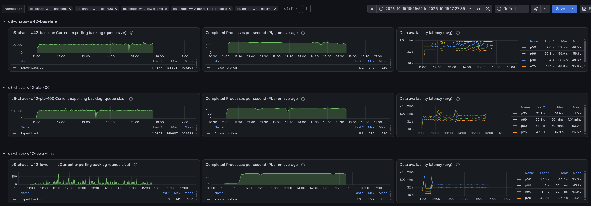
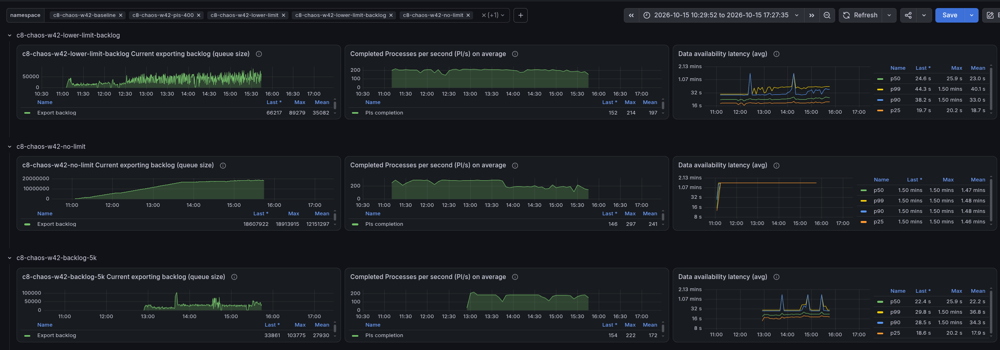


- **Base:** 246 PIs/s at the start, on mean around 220 PIs/s. About +/-105k records not exported as backlog, which creates a data availability of ~60 seconds per partition.
- **More PIs:** Shows quite similar picture to the base, with 239 to 225 PIs/s, with similar backlog etc.
- **Lower write limit:** at the start 3 PI/s, later about 30 PIs/s (after configuration change, see below). The backlog was close to zero, still the data availability was unexpectedly high.
- **Lower backlog (10k):** 150 to 210 PIs/s, mean around 200. The backlog stayed on mean around 35k records per partition.
- **No flow control:** high processing throughput, about 295 PIs/s for the first 2.5 hours, then about 190 PIs/s. The total backlog grew to about 46 million records. Data availability was no longer measurable.
- **Backlog 5k:** Started with 220 as well, then dropped to 173 to 182 PIs/s. The backlog was on mean around 30k records per partition. Data availability was the best we measured among all configurations.


#### Base

The base behaved as in previous runs, with a backlog of about 105k records per partition per exporter.

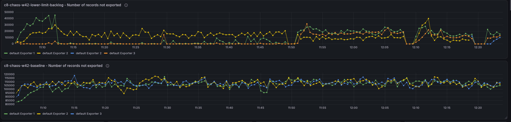

While looking at the base we noticed that deployments are continuously distributed to the other partitions. Our k6 script deploys the same resources again and again. A redeploy of identical resources should be idempotent, but a command distribution is created every time. Something we need to follow up with.

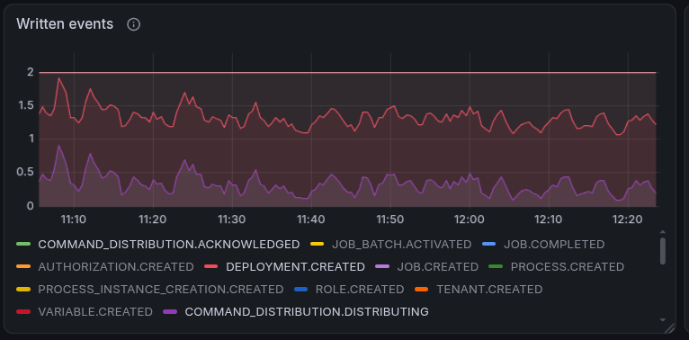

#### Lower write limit

When setting the write limit to a lower value, we tried to estimate what this would mean to our throughput. As this is not obvious from the user point of view (when setting record limit).

We tried to approximate how many records a single PI writes in our load test for our stress workload, where we just have one start event, a service task and end event. This means we have three flow node instances and one process instance container. For each of them we can expect that we write ~4 records. See related investigation (TODO link to gh issue) and ZEP (TODO link to ZEP) for more details. In addition we know that we create one job per service task (~3 records), and we create 14 variables per process instances (see [typical payload](https://github.com/camunda/camunda/blob/main/load-tests/load-tester/src/main/resources/bpmn/typical_payload.json)).

```sh
# Number of records per flow node instance
fni=4

# Number of records per job
job=3

# Number of records per process instance container
picontainer=4

# Number of variables per process instance
variables=14

# Total number of records per process instance
total_records=( (1 * picontainer) + (4 * fni) + (1 * job) + variables )
```

This makes `37` records per process instance. As this configuration is set to 100 we can expect ~2.7 PIs/s per partition. Meaning for our whole cluster around ~8 PIs/s.

When we look at the metrics, we can see that the throughput aligns with our expectations for one partition only

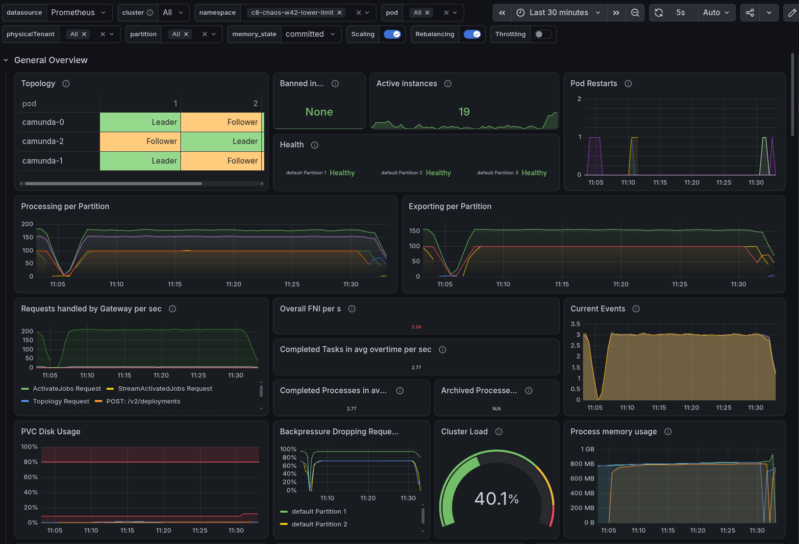

Looking closer, partition one did much more than the other partitions.

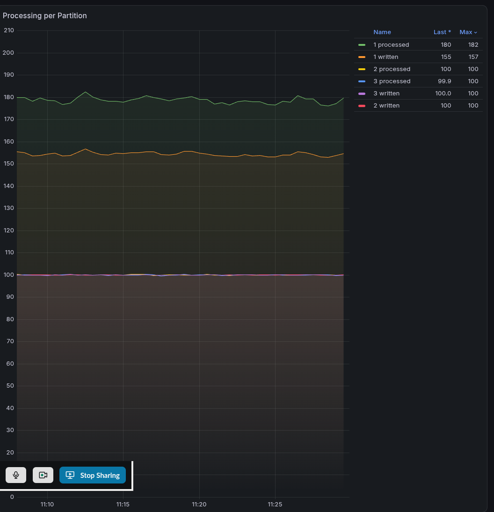

Only partition one created PIs, jobs and variables.

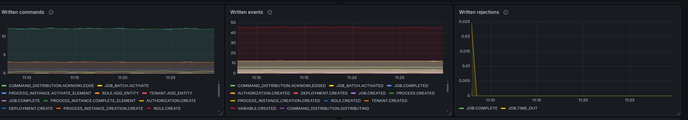

The other partitions only received PI creation commands, and almost everything was rejected.

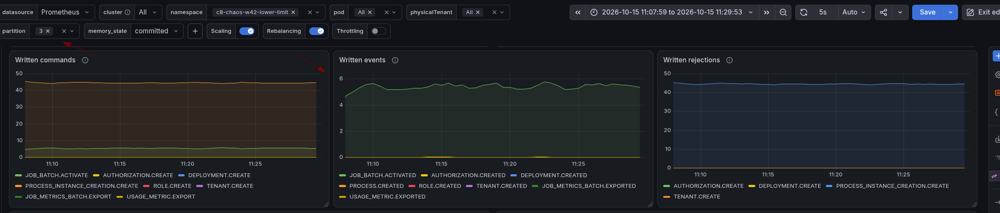

We also saw authorization commands being rejected and retried. These commands are created internally to bootstrap a partition. Our theory is that the rejections prevented the partitions from bootstrapping fully.

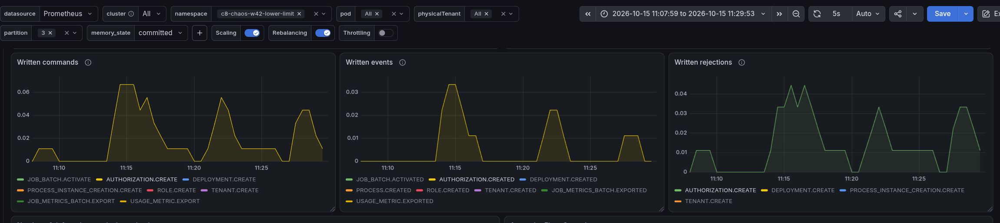

The deployment distribution was affected as well. It could not succeed while the partitions were rejecting commands.

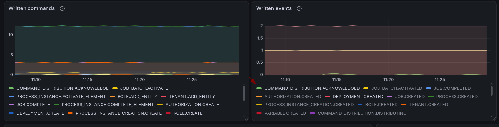


##### Raising the limit

We raised the limit from 100 to 350 to see whether the limit correlates with what we saw in the metrics. After the change the authorization commands succeeded, the partitions started to complete jobs, and the deployment distribution finished.

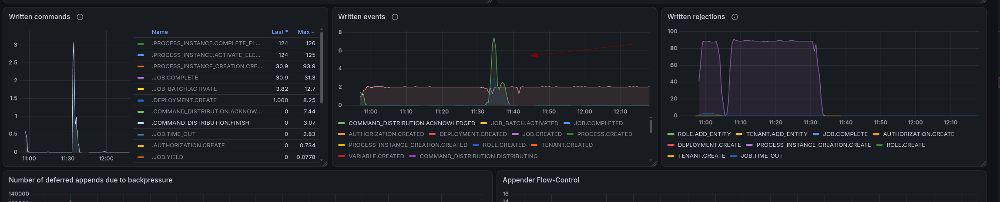

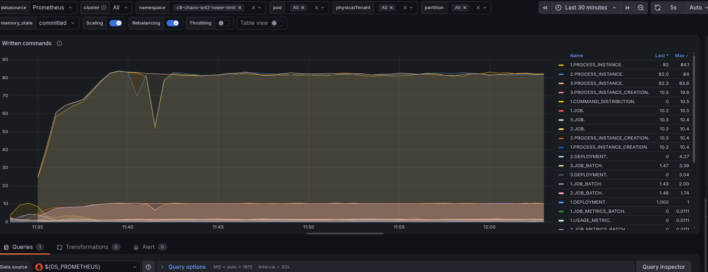

With a limit of 350 (and 37 records per process instance) we would expect ~10 PIs/s per partition and indeed the cluster reached about 30 PIs/s and about 600 records/s.

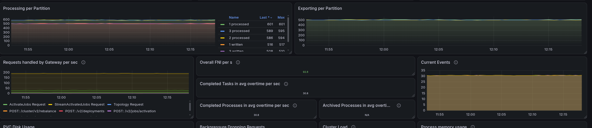

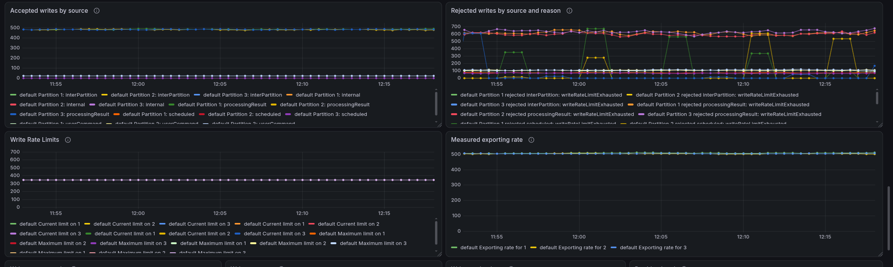


#### Lower backlog

With an acceptable backlog of 10k we still reached a high throughput of about ~200 PIs/s.

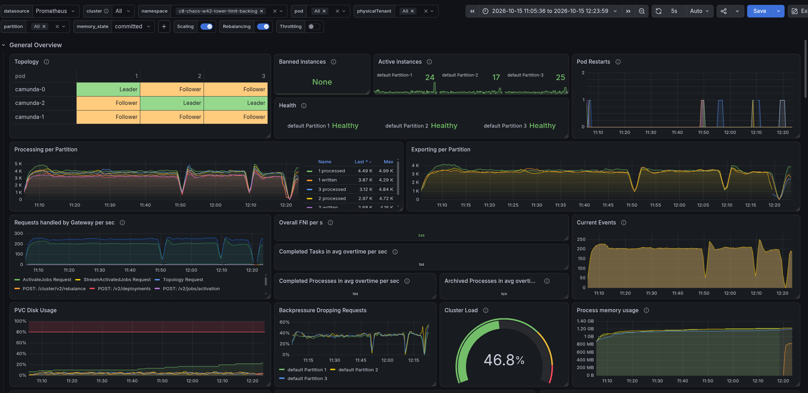

The exporter backlog is much lower than in the base, not about a factor of 10. It is not exactly the configured value, so the setting does not behave like a hard per-second bound.

What we are configuring here is the soft limit of the exporter backlog. It determines how many records can be queued before flow control kicks in, but it does not act as a strict per-second limit.

Important to note here is that a higher limit doesn't necessary help, as this only a short-term buffer and does not increase the exporter's processing capacity. The key factor is how fast the exporter can process the queued records. The queue limit, has an direct effect on the data availability latency. 

This directly related to queuing theory (like Little's Law).
<!-- 

Note for my self  - we can calculate the maximum processing throughput - or max PI/s when we know the exporting throughput and the number of records per process instance. HOLY SH!@@#
```

Type "help", "copyright", "credits" or "license" for more information.
>>> 7000 / 37
189.1891891891892
>>> 7000 / 30
233.33333333333334
>>> 7000 / 32
218.75
>>> 

``` -->

#### No flow control

Without flow control (no exporter backlog limit) we reached about 295 PIs/s, but the exporter backlog kept growing until it reached about 46 million records. The exporting throughput is lower than the processing throughput, so nothing slows the processing down.

At somepoint we hit an natural limit, the disk space, which is our new limit for the exporter backlog. Camunda has the property to stop processing when the exporter backlog reaches the disk space limit, preventing further data accumulation. 

Interesting to note, we then reach again a similar processing throughput as with the base or lower backlog before, but with just a much higher backlog and data availability (or in queuing theory terms, a higher system waiting time). Everything is now again influenced/controlled by the exporter throughput.


<!-- 

TODO Can we draw a nice SVG with showing incoming load large or small queue and 

Example we could show a funnel with incoming load at the top and the queue size the funnel at self and at the bottom the exporting throughput, illustrating how the backlog affects the system. And might overflow and that changing our limits only adjustes the funnel but not the throughput itself?

 -->

#### Comparison and the 5k backlog

In the investigation and discussion we realized that the acceptable backlog only tunes the data availability. A large backlog leads to a large export delay and a small backlog to a small one.

The throughput is only slightly affected by the limit. What matters more is how fast the exporter cleans up and how fast new data can be accepted. Without flow control we reach 300 PIs/s because the exporter throughput is not respected (until we reach the disk limit). With the backlog enabled, processing waits for the exporter, so the exporter throughput sets the pace.

This led to a thought: what if the backlog is lower than the throughput the exporter can sustain? How would the system behave? Would we still be able to achieve the same throughput with an even better data availability?

We started `c8-chaos-w42-backlog-5k` to test this. We expected a lower backlog and better data availability at the same throughput, unless the limit is too low, in which case the throughput suffers.

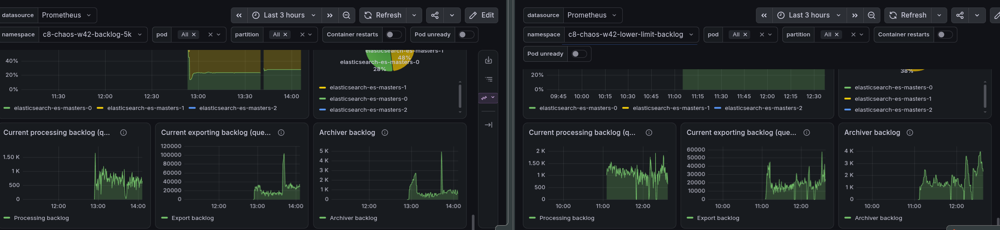

The exporter throughput was about 7k records/s. A backlog of 5k is about 30% below that, and processing throughput dropped by about 20% (188 PIs/s compared to 218 PIs/s with 10k). Thinking about this in more detail this makes also sense as we now limit our system by the queue size and no longer by our exporting rate (service rate).

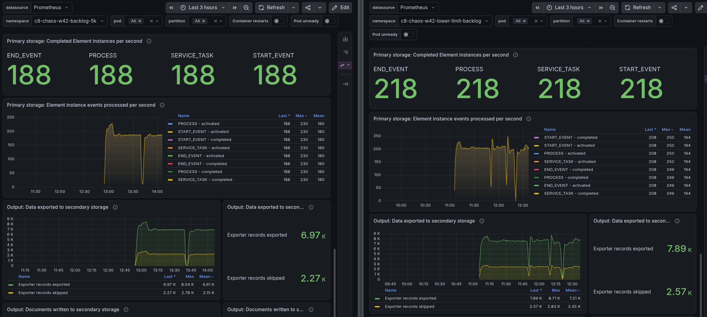

We assume a backlog around 8k gives the best combination of throughput and data availability. We did not test that.
The backlog also did not shrink as much as we expected. We did not find out why.

#### Uneven load on Elasticsearch

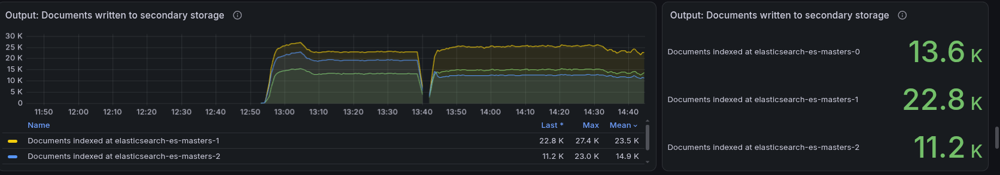

While looking at the 5k cluster we saw an uneven distribution of documents across the Elasticsearch shards, which in general impacts our throughput as well.

Looking into shard distribution, we can see that some shards hold significantly more documents than others. In addition, we stumbled over some indicies with more shards than expected.

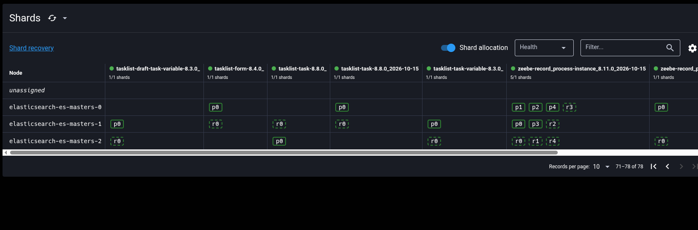

```
$ curl -s "localhost:9200/_cat/shards/zeebe*?v=true&bytes=gb"
index                                           shard prirep state       docs store dataset ip           node
zeebe-record_process-instance_8.11.0_2026-10-15 0     p      STARTED  3021041     0       0 10.152.31.66 elasticsearch-es-masters-1
zeebe-record_process-instance_8.11.0_2026-10-15 1     p      STARTED        0     0       0 10.152.25.2  elasticsearch-es-masters-0
zeebe-record_process-instance_8.11.0_2026-10-15 2     p      STARTED        0     0       0 10.152.25.2  elasticsearch-es-masters-0
zeebe-record_process-instance_8.11.0_2026-10-15 3     p      STARTED  2708256     0       0 10.152.31.66 elasticsearch-es-masters-1
zeebe-record_process-instance_8.11.0_2026-10-15 4     p      STARTED  2898537     0       0 10.152.25.2  elasticsearch-es-masters-0
```

Of the five process instance shards, two are empty. The exporters route each document by its partition id, so with three partitions only three distinct routing values exist, and these can collide in the same shard. [camunda/camunda#56522](https://github.com/camunda/camunda/pull/56522) changes the shard counts to address this.

We also noticed that many indices exist but hold no documents. Every shard has an overhead, see [Elastic's shard sizing guidance](https://www.elastic.co/docs/deploy-manage/production-guidance/optimize-performance/size-shards#each-shard-has-overhead). Our theory is that these empty indices and shards cost memory, but we did not verify it. Something we want to follow up with.


## Conclusion

- **Base:** as expected, about 220 PIs/s and about 105k records not exported per partition.
- **More PIs:** the same result as the base, so 300 PIs/s already stresses the cluster.
- **Lower write limit:** a significant throughput drop, as expected. In addition a limit of 100 prevented partitions from bootstrapping, and the cluster recovered after we raised it. This test allowed us to better understand and calculate expected PI throughput under different write limits.
- **Lower backlog:** a smaller throughput drop than expected (about 10%), with a much lower backlog.
- **Backlog below the exporter throughput:** processing throughput dropped by about 20%.
- **No flow control:** more throughput than the others for a while, but a growing backlog and a throughput drop later on.

The acceptable backlog is the knob for data availability, and the write limit protects the partitions in a way that is hard to reason about. A low limit can make a cluster unusable.

As we have no control of index and sharding placement in Elasticsearch, this can lead to uneven load distribution, causing noise in our tests.

Flow control is an interesting and important configuration, but needs expert knowledge to tune correctly (at least right now). Misconfigurations can lead to unexpected throughput drops or higher data availability. It should be enabled with default configuration, to prevent large disk usage and reduce data availability.

We should consider to make it default in general, something we need to follow up with, to keep data availability and disk usage under control on overloaded clusters and ensure more predictable performance.

### Load tests configurations

We plan to change our load test setup to cover the default (vanilla) configuration we ship, without flow control and without our other custom tweaks. In oder to make sure we test what we ship. Tests with a specific flow control configuration run additionally, as separate scenarios (or ideally it becomes the default).


Sidenote: 

After the experiments we started `c8-chaos-w42-no-limit-realistic`, a cluster with the default configuration and a more realistic load. It processes about 50 PIs/s with an exporting latency p99 of about 0.5 s and almost no backlog. This means flow control as no general affect if the cluster performs in its bounds, and has only an affect when it is overloaded/saturated.

## Found Bugs
<!-- Open issues for such -->

- Deployments are redistributed on every redeploy, even if the resources are identical.
- Elasticsearch shards are unevenly used, see related [camunda/camunda#56522](https://github.com/camunda/camunda/pull/56522). 
- Open question: why do we create indices that are never used?
