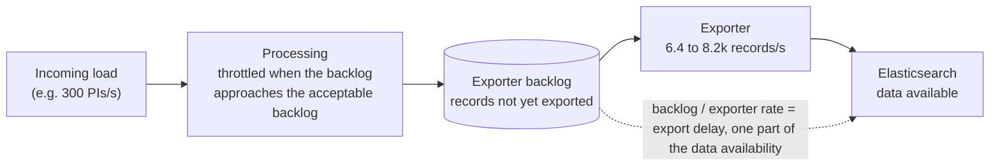
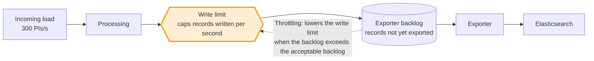
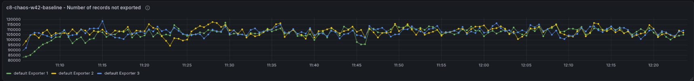
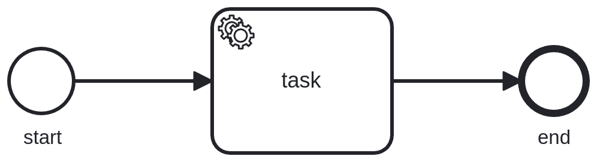
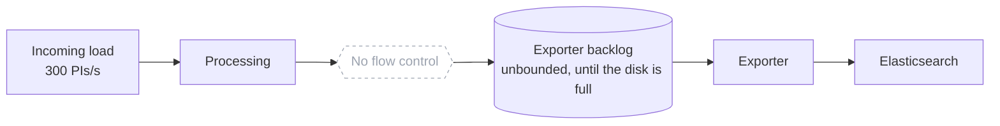

# Chaos Day Summary

While writing our [Sizing documentation for Camunda](https://docs.camunda.io/docs/next/components/best-practices/architecture/sizing-your-environment/), we noticed that our previous load tests did not account for the default flow control settings. This impacted for example our experiments for [Camunda 8.7 and beyond performance and reliability results](https://camunda.github.io/zeebe-chaos/2026/08/14/Camunda-8.7-and-beyond---performance-and-reliability). That means our results did not describe what we ship.

Today we ran several load tests with different flow control settings to understand how flow control affects throughput and data availability, and whether our earlier results need a correction.

<!--truncate-->

**TL;DR;**



The acceptable backlog steers the size of the queue in the middle, and with it the export delay. This is one part of the data availability, which the load tester measures from creating an instance until it is available via the REST API. The exporter rate on the right decides how many records per second can pass. A larger queue does not add capacity, and a too small queue can even lower it, as the 5k run showed. The exporter rate was not the same in every run (6.4k to 8.2k records/s). We expect that the uneven distribution of the load across the Elasticsearch shards is the reason (see below), we did not verify this.

- **The limit of the system is most likely the exporter.** The maximum sustainable PIs/s is the exporter throughput divided by the exported records per PI. On the base cluster the exporter handled about 8.2k records/s at about 37 exported records per PI, which gives about 220 PIs/s.
- **Without flow control an overloaded cluster fills its backlog.** Under the stress workload the cluster processed about 295 PIs/s for roughly 2.5 hours, while the exporter backlog grew to about 19 million records per partition, until the disks were almost full.
- **The acceptable backlog steers the data availability.** Flow control steers the exporter backlog towards a soft limit, and with it the data availability: p99 was about 59s with the default 100k, 44s with 10k and 30s with 5k.
- **Both knobs can hurt.** A backlog lower than the serving rate costs throughput (5k per partition cost about 13% compared to 10k), and a write limit of 100 starved the partitions (only partition one made progress).
- **Under a realistic load (~51 PIs/s) no flow control was needed.** The default configuration without our flow control settings ran stable for about 22 hours, with a p99 data availability of 3.9s and almost no backlog.
- We found two bugs along the way: deployments are redistributed on every redeploy ([camunda/camunda#66171](https://github.com/camunda/camunda/issues/66171)), and Elasticsearch shards are unevenly used ([camunda/camunda#66172](https://github.com/camunda/camunda/issues/66172)).

## Chaos Experiment

As we wanted to understand how flow-control works and impacts the system we ran several load tests with different flow control settings.

We used the stress workload, 300 PIs/s with a process of one task (start event, service task, end event), and our [default load test setup](https://github.com/camunda/camunda/blob/880ec51f24c5dff162f70257d27059595bd4cd99/load-tests/setup/main/values/camunda-platform-values-defaults.yaml#L246-L252) as the base (using the REST API). Our default load test setup enables the following flow control configuration:

```yaml
camunda.processing.flow-control.write.enabled: "true"
camunda.processing.flow-control.write.limit: 10000
camunda.processing.flow-control.write.throttle.enabled: "true"
```

See the [flow control documentation](https://docs.camunda.io/docs/next/self-managed/operational-guides/configure-flow-control/#enable-flow-control) for the meaning of these settings. The default of `acceptable-backlog` is 100000 (`camunda.processing.flow-control.write.throttle.acceptable-backlog`), which we haven't changed in our default setup. Note that Camunda itself ships with the write limit and the throttling disabled, see the [configuration defaults](https://github.com/camunda/camunda/blob/93eed7e8765965643acda91fc6e389d0328155b8/dist/src/main/config/defaults.yaml#L1806-L1821). Only the request limit (backpressure, see the [defaults](https://github.com/camunda/camunda/blob/93eed7e8765965643acda91fc6e389d0328155b8/dist/src/main/config/defaults.yaml#L1761-L1762)) is enabled by default.

Flow control acts in two places on the write path of a partition. The write limit caps how many records per second the processing may write, and a rejected write is retried by the engine. The throttling starts to lower this limit when the exporter backlog is larger than half of the acceptable backlog, and limits harder the larger the backlog gets. Each variation below changes one of these knobs, highlighted in the diagram of its section (the base diagram highlights the knob of our default setup):



We started one cluster per variation:

- **Base** (`c8-chaos-w42-baseline`): 300 PIs/s, default load test setup.
- **More PIs** (`c8-chaos-w42-pis-400`): `load-tester.starter.rate: 400`.
- **Lower write limit** (`c8-chaos-w42-lower-limit`): `camunda.processing.flow-control.write.limit: 100`.
- **Lower backlog** (`c8-chaos-w42-lower-limit-backlog`): `camunda.processing.flow-control.write.throttle.acceptable-backlog: 10000`.
- **No flow control** (`c8-chaos-w42-no-limit`): the three lines above removed from the default load test setup (this uses the Camunda default flow control settings, the other settings of the load test setup, like the disk watermarks, stay).

Later we added a sixth cluster after discussing the results:

- **Backlog 5k** (`c8-chaos-w42-backlog-5k`): `camunda.processing.flow-control.write.throttle.acceptable-backlog: 5000`.

### Expected

Before we started with our tests we made some expectations based on our current understanding of the flow control settings and the system behavior.

- **Base:** as usual about 220 PIs/s, a backlog of about 100k records per partition, and a data availability delay of 40 to 60 seconds.
- **More PIs:** we already reach the limit with 300 PIs/s, so more load should not change the result. It might even be slightly worse because of overstress.
- **Lower write limit:** a significant throughput drop, but good data availability and no backlog.
- **Lower backlog:** a throughput drop, good data availability, and a backlog as configured.
- **No flow control:** more PIs/s, but a huge backlog and worse data availability than the other configurations.

### Actual

The numbers below come from Prometheus over the whole run (about 3 to 4 hours per cluster). The backlog is the number of records not yet exported, per partition (3 partitions) and the data availability the time from creating an instance until it is available via the REST API, as measured by the load tester (see [metrics documentation](https://github.com/camunda/camunda/blob/cccaef90819cd9456cfa4d3b2a3039a08ed8c84a/load-tests/docs/metrics.md#L215-L218)). Data availability is given as p50 over the whole run and as p99 in the steady state of the panel (single 15 minute windows of the 10k and 5k runs reached the top bucket of 90s, which presumably relates to restarts of the cluster).


| Cluster | PIs/s | Exported records/s | Backlog per partition | Data availability p50 | p99 |
|---|---|---|---|---|---|
| Base | 226 | 8.24k | about 105k | 40s | 59s |
| More PIs | 220 | 8.15k | similar to base | 41s | 60s |
| Lower write limit | 3, later about 30 | about 1k | close to zero | 37s | 45s |
| Lower backlog (10k) | 198 | 7.34k | about 35k | 23s | 44s |
| Backlog 5k | 173 | 6.41k | about 28k | 22s | 30s |
| No flow control | about 295, later 150 to 200 | about 6.8k | about 19M | top bucket (90s) | top bucket (90s) |


#### Base


The base behaved as in previous runs, with a backlog of about 105k records per partition per exporter.



While looking at the base we noticed that deployments are continuously distributed to the other partitions. Our k6 script deploys the same resources again and again. A redeploy of identical resources should be idempotent, but a command distribution is created every time. Something we need to follow up with.


#### Lower write limit


Changed here: the write limit of the processing is lowered to 100 records/s per partition.

When setting the write limit to a lower value, we tried to estimate what this would mean to our throughput, as the effect of a record limit is not obvious from the user point of view.

We tried to approximate how many records a single PI writes in our load test for the stress workload. Each process instance and flow node instance writes ~4 records, a job ~3 records, and we create 14 variables per process instance (see [typical payload](https://github.com/camunda/camunda/blob/main/load-tests/load-tester/src/main/resources/bpmn/typical_payload.json)). See [ZEP-004](https://github.com/zeebe-io/enhancements/blob/master/ZEP004-wf-stream-processing.md) for how the stream processing writes these records, and [camunda/camunda#61073](https://github.com/camunda/camunda/issues/61073) for related work on sizing by records per process model.



```python
# Number of records per flow node instance
fni = 4
# Number of records per job
job = 3
# Number of records per process instance container
picontainer = 4
# Number of variables per process instance
variables = 14

# Total number of records per process instance
# Our process has three flow nodes (start event, service task, end event)
total_records = (1 * picontainer) + (3 * fni) + (1 * job) + variables
print(total_records)  # 33
```

This makes `33` records per process instance. As the limit is set to 100 per partition we can expect ~3 PIs/s per partition (`100 / 33`), which is about 9 PIs/s for our whole cluster.

When we look at the metrics, we can see that the throughput aligns with our expectations for one partition only.


Looking closer, partition one did much more than the other partitions.
Only partition one created PIs, jobs and variables.


The other partitions only received PI creation commands, and almost everything was rejected.


We also saw authorization commands being rejected and retried. These commands are created internally to bootstrap a partition. Our theory is that the rejections prevented the partitions from bootstrapping fully.


The deployment distribution was affected as well. It could not succeed while the partitions were rejecting commands.


The data availability was high as well (p50 37s, p99 45s), although the exporting latency p99 was only about 0.09s and there was no backlog. This means the delay is not caused by the exporter. Our theory is that the write limit slows down the processing: commands like the PI creation are accepted, but their follow-up writes are rejected by the limit and retried by the engine until capacity is free again. The instance is then created and visible late. We did not verify this.

##### Raising the limit

We raised the limit from 100 to 350 to see whether the limit correlates with what we saw in the metrics. After the change the authorization commands succeeded, the partitions started to complete jobs, and the deployment distribution finished.


With a limit of 350 (and 33 records per process instance) we would expect ~10 PIs/s per partition (`350 / 33`) and indeed the cluster reached about 30 PIs/s. The accepted writes were about 480 records/s per partition though, which is higher than the configured limit of 350. We did not investigate how exactly the limit maps to the accepted writes (for example which write sources count against it).


#### Lower backlog


Changed here: the acceptable backlog is lowered to 10k. It is a soft limit, the throttling steers the exporter backlog towards the value but does not enforce it.

With an acceptable backlog of 10k we still reached a high throughput of about ~200 PIs/s.


The exporter backlog is about three times lower than in the base (about 35k vs 105k per partition). The measured backlog was therefore above the configured 10k.

Important to note here is that a higher acceptable backlog doesn't necessarily help, as this is only a short-term buffer and does not increase the exporter's processing capacity. The key factor is how fast the exporter can process the queued records. The queue limit has a direct effect on the data availability latency. 

This is directly related to queuing theory (like Little's Law): the waiting time in a queue is its size divided by the rate at which it is served. For the backlog this estimates the export delay, which is only one part of the data availability measured through the REST API.


#### No flow control



Changed here: there is no limit on the write rate and no throttling, so there is no bound on the exporter queue.

Without flow control (no exporter backlog limit) we reached about 295 PIs/s, but the exporter backlog kept growing until it reached about 19 million records per partition.

At around 13:40, about 2.5 hours after the start, the disks of the Camunda pods were almost full (about 97%). This lines up with the throughput drop.


This is what queueing theory predicts. The records arrived faster (about 10.9k records/s) than the exporter served them (about 7k records/s), so the queue grew until a finite resource was exhausted, here the disk. Afterwards the system can only admit as much as it serves, about 190 PIs/s (`7000 / 37`, with 37 exported records per PI: the 33 written plus the continuous deployments, see Found Bugs).

We measured about 150 to 200 PIs/s afterwards, with a much higher data availability delay. The most likely cause is the disk monitoring of the broker (we did not check the rejected commands): our load test setup rejects client commands and pauses processing when less than 3GB of disk space is free, and stops accepting replicated events below 2GB ([load test configuration](https://github.com/camunda/camunda/blob/880ec51f24c5dff162f70257d27059595bd4cd99/load-tests/setup/main/values/camunda-platform-values-defaults.yaml#L240-L241), the [defaults](https://github.com/camunda/camunda/blob/93eed7e8765965643acda91fc6e389d0328155b8/dist/src/main/config/defaults.yaml#L548-L559) are 2GB and 1GB). Processing presumably continues when snapshots and compaction free space again, which would explain why the disk usage stays at the watermark. So the free space watermark was most likely the effective limit for the backlog, not flow control.


#### Comparison and the 5k backlog


The 5k cluster lowers the acceptable backlog even further, to 5k records per partition.

In the investigation and discussion we realized that the throughput is only slightly affected by the limit. What matters more is how fast the exporter cleans up and how fast new data can be accepted. Without flow control we reach 300 PIs/s because the exporter throughput is not respected (until we reach the disk limit). With the backlog enabled, processing waits for the exporter, so the exporter throughput sets the pace.

This led to a thought: what if the backlog is lower than the throughput the exporter can sustain? How would the system behave? Would we still be able to achieve the same throughput with an even better data availability?

We started `c8-chaos-w42-backlog-5k` to test this. We expected a lower backlog and better data availability at the same throughput, unless the limit is too low, in which case the throughput suffers.


We observed a lower throughput with the 5k backlog. The most likely reason is the lower limit itself. The throttling admits less once the backlog is larger than half of the acceptable backlog (about 2.5k records per partition for 5k), so a smaller buffer blocks more of the arriving load, even if the exporter serves at the same rate (in queueing theory a finite queue loses throughput as it shrinks).


We assume a backlog around 8k gives the best combination of throughput and data availability. We did not test that.

The backlog also did not shrink as much as we expected. We did not find out why.

#### Uneven load on Elasticsearch


While looking at the 5k cluster we saw an uneven distribution of documents across the Elasticsearch shards. We observed this in other load tests as well, where the throughput varied too, which is how we noticed it. We did not measure whether the uneven distribution is the cause.


Of the five shards of the process instance index two are empty. The exporters route each document by its partition id, so with three partitions only three routing values exist, and they can collide on the same shard. The heavy single-shard indices of Operate, Tasklist and Camunda are uneven as well, as Elasticsearch places shards by count and disk usage, not by indexing load. In the 5k run the documents indexed per second of the three Elasticsearch nodes differed (about 22.8K, 13.6K and 11.2K), so our test results depend on how the shards happen to be placed. The routing simulation, the shard listings and the related fix are in [camunda/camunda#66172](https://github.com/camunda/camunda/issues/66172).

We also noticed that many indices exist but hold no documents, and every shard has an overhead. We track this in [camunda/camunda#66173](https://github.com/camunda/camunda/issues/66173).


## Conclusion

The acceptable backlog is the knob for data availability, and the write limit protects the partitions in a way that is hard to reason about. A low limit can make a cluster unusable. The maximum sustainable throughput is most likely bound by the exporter, so flow control can only trade data availability against throughput, it cannot add capacity.

As we have no control of index and sharding placement in Elasticsearch, this can lead to uneven load distribution, which we expect causes noise and throughput drops in our tests. This is how we noticed it in the first place.

Under realistic load, the default configuration without any flow control worked fine. After the experiments we started `c8-chaos-w42-no-limit-realistic`, a cluster with the default configuration (no write limit, no throttling) and a more realistic load. It has been running for about 22 hours and processed a stable ~51 PIs/s the whole time, with a data availability p50 of 1.6s and p99 of 3.9s, an exporting latency p99 of about 0.5s and almost no backlog. The exporter keeps up, so there is nothing for flow control to do. It only has an effect when the cluster is overloaded, like in the stress scenario.

### Load tests configurations

Our load tests did not describe what we ship, because they enabled the write limit and the throttling, while Camunda ships with both disabled.

This affects our earlier results as well, for example [Camunda 8.7 and beyond performance and reliability results](https://camunda.github.io/zeebe-chaos/2026/08/14/Camunda-8.7-and-beyond---performance-and-reliability). They used the same configuration (write limit 10000 and throttling with the default acceptable backlog) and ran with a high load, which is exactly the situation where flow control has an effect. Their throughput and data availability numbers therefore reflect the throttling and not the default configuration, and they should be read with that in mind or repeated.

We plan to change our load test setup to cover the default (vanilla) configuration, without our flow control settings and without our other custom tweaks, to make sure we test what we ship. Tests with a specific flow control configuration run additionally, as separate scenarios.

This is independent from the question whether Camunda should ship with flow control enabled. The `no-limit` run shows what the default flow control does when the cluster is overloaded: a backlog without a flow control bound and a growing data availability delay, until (most likely) the disk free space watermark was reached. Flow control needs expert knowledge to tune (at least right now), but a conservative default of the throttling (with an acceptable backlog) could keep data availability and disk usage under control. We have to follow up on this separately.

## Found Bugs

- Deployments are redistributed on every redeploy, even if the resources are identical, see [camunda/camunda#66171](https://github.com/camunda/camunda/issues/66171).
- Elasticsearch shards and heavy indices are unevenly distributed, for the indices we looked at (Zeebe, Operate, Tasklist, Camunda) and for several partition counts in our routing simulation, see [camunda/camunda#66172](https://github.com/camunda/camunda/issues/66172) (related fix: [camunda/camunda#56522](https://github.com/camunda/camunda/pull/56522)).
- Open question: why do we create indices that are never used, and what do they cost? See [camunda/camunda#66173](https://github.com/camunda/camunda/issues/66173).
